# PaperDesk user guide

This guide is for the person who runs PaperDesk: one owner, on a Windows PC, using it in the PC's
browser and in a phone browser on the same Wi-Fi. It describes what the program does today, as
checked against the code on the branch it was written for. Where something is simulated or
approximate, it says so. For a one-page start, read [QUICK_START.md](QUICK_START.md). For a plain
list of what is simulated, approximate, untested or missing, read [KNOWN_LIMITS.md](KNOWN_LIMITS.md).

Contents

1. [What PaperDesk is and is not](#1-what-paperdesk-is-and-is-not)
2. [Install and first start on Windows](#2-install-and-first-start-on-windows)
3. [macOS, Linux and Docker](#3-macos-linux-and-docker)
4. [A tour of the screen](#4-a-tour-of-the-screen)
5. [Placing orders](#5-placing-orders)
6. [How orders are filled](#6-how-orders-are-filled)
7. [Accounts, margin and rules](#7-accounts-margin-and-rules)
8. [Options](#8-options)
9. [Reports](#9-reports)
10. [Replay mode](#10-replay-mode)
11. [Alerts, watchlist, screener and research](#11-alerts-watchlist-screener-and-research)
12. [Using PaperDesk on a phone](#12-using-paperdesk-on-a-phone)
13. [Real market data](#13-real-market-data)
14. [Troubleshooting](#14-troubleshooting)
15. [Glossary](#15-glossary)

Sections that will need updating when other work lands are marked **Will change**. At the time of
writing, a new order ticket with a strategy builder, a provider update and chart tools (drawing
tools, more indicators, keyboard shortcuts) are being built on separate branches.

---

## 1. What PaperDesk is and is not

PaperDesk is a **simulator**. You practise buying and selling stocks and options with pretend money.
It runs on your own computer.

- **No real orders.** PaperDesk never sends an order to a broker or an exchange. There is no code in it
  that can. Nothing you do here moves real money.
- **Prices are simulated by default.** The companies (MKTX, TECX, NVLX, ORBT and others) are fictional.
  Their prices follow a random walk that the program generates. Option prices come from a pricing
  formula. With a free Alpaca key you can switch to real quotes (section 13). Orders are still only
  simulated.
- **Fills are an approximation.** A real market has queues, hidden orders and other traders. PaperDesk
  uses a simple, cautious model (section 6). Doing well here does not mean you would do well with real
  money.
- **Not advice.** Nothing on screen, in reports or in this guide is investment, tax or legal advice.
- **One person.** There are no user accounts. A passcode (section 12) keeps other devices on your
  network out; it is not a login for several people.
- **It only moves while it runs.** Simulated prices do not move, and orders do not fill, while the
  PaperDesk window is closed.

Every screen shows a banner, "Paper trading · no real money", plus where the prices come from.

---

## 2. Install and first start on Windows

Allow about ten minutes. You need an internet connection for the first start only (to download the
Python packages PaperDesk uses). The Windows path has been checked by an automated test but, at the
time of writing, not by hand on a real PC. If a step does not match what you see, see
[Troubleshooting](#14-troubleshooting).

### Install Python

1. Go to <https://www.python.org/downloads/windows/> and download the latest **Python 3** installer
   (version 3.11 or newer; 3.13 works).
2. Run it. On the first screen **tick "Add python.exe to PATH"** (at the bottom), then choose
   **Install Now**.
3. When it finishes, close the installer.

You do not need Node.js, Git or any other tool.

### Get PaperDesk

1. On the PaperDesk page on GitHub, press the green **Code** button, then **Download ZIP**.
   (If you know Git, `git clone` works too.)
2. Open your Downloads folder, right-click the ZIP file and choose **Extract All**. Pick a folder you
   will keep, such as `C:\PaperDesk`. Do not run it from inside the ZIP.

You should now have a folder that contains `run.bat`, `README.md`, `.env.example` and the folders
`backend`, `frontend` and `docs`.

### First start

1. Double-click **`run.bat`**. A black window opens.
2. The first time, it prints `Setting up PaperDesk (first start takes a minute)...`. It is creating a
   private Python environment inside `backend\.venv` and downloading packages. Wait for it.
3. When it is ready, the window shows `PaperDesk is starting on http://127.0.0.1:8000`, then a few
   lines starting with `INFO:`, ending with `Uvicorn running on http://127.0.0.1:8000`.
4. Your browser opens PaperDesk by itself. If it does not, open a browser and type
   `http://127.0.0.1:8000` into the address bar.
5. Leave the black window open. **PaperDesk runs only while that window is open.**

The first start creates two accounts: a **Margin account** with $100,000 and a **Cash account** with
$25,000, and a watchlist of ten fictional companies.

The first time you run it, Windows may show a firewall prompt. In the default setup PaperDesk only
listens on this computer, so you can press **Cancel**. The prompt matters only for phone access
(section 12).

If the window shows an error and then "Press any key to continue", read the line above it. The most
common one is `PaperDesk needs Python 3.11 or newer, and none was found.`: install Python as above,
making sure "Add python.exe to PATH" is ticked, then double-click `run.bat` again.

### Stop PaperDesk

Press **Ctrl+C** in the black window, or close the window. PaperDesk saves your accounts within a couple of seconds of any change and once more when it shuts down cleanly. Closing the window with the
cross is a rough stop: the last few seconds of activity could be lost. Ctrl+C is cleaner.

To start again, double-click `run.bat`. Later starts take a few seconds.

### Where your data is stored

Everything PaperDesk saves is in one folder: `backend\data` inside the PaperDesk folder (for example
`C:\PaperDesk\backend\data`). It contains:

| File | What it holds |
|---|---|
| `state.json` | Your accounts, orders, fills, positions, watchlist, alerts and journal |
| `market.json` | The simulated market's last prices (refreshed about once a minute) |
| `sessions.json` | Phone sign-ins (only if you turn on a passcode) |
| `replay\` | A scratch folder for replay mode; emptied at each replay start |
| `alpaca\` | The separate saved state used with real market data (section 13) |

**Back up:** stop PaperDesk, then copy the whole `backend\data` folder somewhere safe (a USB stick or
cloud folder). To restore, stop PaperDesk and copy it back.

**Reset one account:** use **Reset** in the top bar (section 4). It erases that account's orders,
positions and history and starts again with the cash you choose.

**Reset everything:** stop PaperDesk and delete the `backend\data` folder (or rename it, to keep a
copy). The next start creates the two default accounts again.

To keep the data somewhere else, set the environment variable `PAPERDESK_DATA` to that folder before
starting (for example, in a Command Prompt: `set PAPERDESK_DATA=D:\PaperDeskData` and then
`run.bat`). Putting `PAPERDESK_DATA` in the `.env` file does **not** work at the moment: the server
ignores it there (see KNOWN_LIMITS.md).

### Update to a newer version

1. Stop PaperDesk. Back up `backend\data` (see above) and your `.env` file if you have one.
2. Download the new ZIP and extract it to a **new** folder, for example `C:\PaperDesk-new`.
3. Copy your old `backend\data` folder into the new folder's `backend` folder, and copy `.env` into the
   new folder's top level (next to `run.bat`).
4. Double-click `run.bat` in the new folder. The first start sets up a fresh Python environment again,
   which takes a minute.
5. When you are happy, delete or archive the old folder.

If you used `git clone`, `git pull` in the folder does the same; your data and `.env` are not in Git
and are left alone. A new version can add or change settings; read its `README.md` and
`.env.example`. Always keep a backup of `backend\data` before updating.

### Change the port

If another program already uses port 8000, PaperDesk will not start (the window shows a message about
the address being in use). In a Command Prompt, in the PaperDesk folder:

```
set PORT=8001
run.bat
```

Then open `http://127.0.0.1:8001`. The `PORT=` line in `.env` is read by Docker only, not by `run.bat`.

---

## 3. macOS, Linux and Docker

**macOS and Linux.** Install Python 3.11 or newer (from python.org or your package manager). In a
terminal, in the PaperDesk folder, run `./run.sh`. It does the same set-up as `run.bat` and prints
`PaperDesk is starting on http://127.0.0.1:8000`. Open that address. Stop with Ctrl+C. Data is in
`backend/data`. The macOS and Linux path is covered by the automated tests.

**Docker.** If you use Docker Desktop:

```
copy .env.example .env      (optional; on macOS and Linux: cp .env.example .env)
docker compose up --build
```

Then open `http://127.0.0.1:8000`. Data lives in a Docker volume called `paperdesk-data`, not in a
folder you can see. `docker compose down` stops it and keeps your data; `docker compose down -v`
**deletes** the data. The compose file publishes the port on this computer only. For the phone steps
under Docker, see the README ("LAN mode in Docker"); every browser, including the one on the PC, has to
sign in there.

---

## 4. A tour of the screen

On a computer (a window at least 900 pixels wide) the screen has three columns.

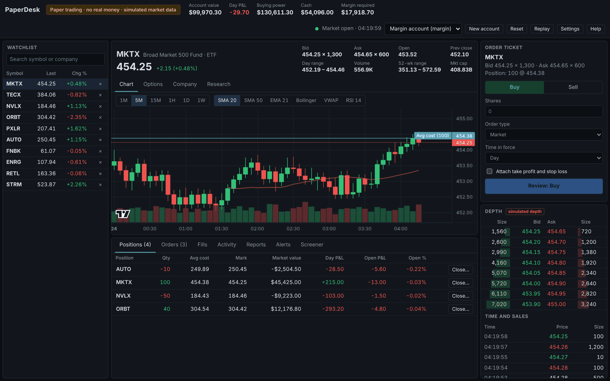

**Top bar.** From left to right:

- The **banner**: "Paper trading · no real money" plus the price source. "simulated market data" means
  fictional prices. A blue banner "Replay of …" means a replay sandbox (section 10). Hover over the
  banner for more detail.
- **Account value** (everything the account is worth now: cash plus positions at market value),
  **Day P&L** (change in account value since the day began), **Buying power** (what you can still
  spend on stocks), **Cash**, and, on margin accounts, **Margin required** (the maintenance
  requirement, section 7).
- A green dot (connected to the PaperDesk server; red means reconnecting), the market state and time
  ("Market open · 04:13:37", in your computer's time zone), the **account menu**, and the buttons
  **New account**, **Reset**, **Replay**, **Settings** and **Help**. **Sign out** appears only on a
  device that had to sign in with a passcode.

**Left: watchlist.** Your list of symbols with last price and change since the previous close. Click a
symbol to show it. Type in the search box (symbol or company name) and press Enter or click a result to
add it. The **×** removes a symbol. There is one watchlist, called Main.

**Centre top.** The symbol's quote (bid, ask and their sizes, open, previous close, day range, volume,
52-week range, market cap), then four tabs:

- **Chart**: candlesticks with volume. Timeframes **1m**, **5m**, **15m** (minutes), **1h** (hour), **1D** (day)
  and **1W** (week); keys 1 to 6 pick them. Indicators you can
  switch on: SMA 20, SMA 50, EMA 21, Bollinger bands, VWAP (intraday timeframes only) and RSI 14. The
  chart draws your average cost as a solid blue line and your open orders as dashed lines. Intraday
  times are in your computer's time zone. The last candle updates as prices arrive.
- **Options**: the option chain (section 8).
- **Company**: facts about the company (market cap, earnings per share, dividend, 52-week range,
  volatility). For the fictional companies these figures are generated.
- **Research**: news, earnings dates, dividends and splits, fundamentals, financial statements, and
  market-wide news with earnings and economic calendars. With simulated prices all of it is simulated for
  the fictional companies and labelled Simulated (`docs/SIMULATED_RESEARCH.md`).

**Centre bottom: your account.** Seven tabs:

| Tab | What it shows |
|---|---|
| **Positions** | What you hold: quantity, average cost, mark, market value, day and open P&L, and a **Close…** button that fills the ticket to sell or buy back the whole position |
| **Orders** | Open orders with **Change…** and **Cancel**, and **Cancel all open orders**; tick "Show finished orders" for filled, canceled, rejected and expired ones |
| **Fills** | Each execution: time, price, fee and kind (trade, exercise, assignment, dividend reinvestment and so on) |
| **Activity** | The ledger: every cash movement with its realised profit or loss |
| **Reports** | Statistics, gains, statements, journal, export (section 9) |
| **Alerts** | Price alerts (section 11) |
| **Screener** | Filter the whole list of symbols (section 11) |

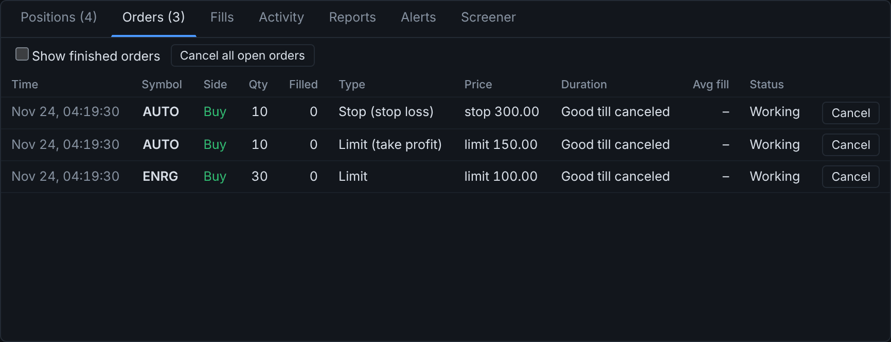

**Right: order ticket, depth, time and sales.** The ticket is section 5. **Depth** shows a ladder of bid
and ask prices and sizes. It is labelled "simulated depth" because PaperDesk builds the ladder from the
top-of-book quote; it is not a real order book, even with real data. **Time and sales** lists recent
trades.

**The marks.** Stocks are valued at the last trade price. Options are valued at the middle of the bid
and ask. Because you buy at the ask and sell at the bid, a new position usually shows a small loss
right away: that is the spread.

---

## 5. Placing orders

### The steps

1. Click a symbol so its name is at the top of the ticket.
2. Choose **Buy** or **Sell**.
3. Enter **Shares** (**Contracts** for an option).
4. Choose the **Order type** and fill in the prices it asks for.
5. Choose **Time in force**.
6. Press **Review: Buy** (the button names the action: Buy, Sell, Sell short, Buy to cover, Buy to open,
   Sell to open, Buy to close, Sell to close).
7. Read the estimate. Press **Place paper order**, or **Edit** to change it.

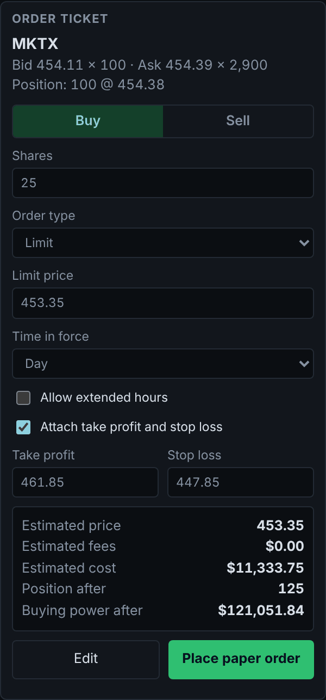

The review shows the estimated price, estimated fees, estimated cost (or proceeds), your position
afterwards and your buying power afterwards, plus warnings (for example "This order opens a short
position." or "The market is closed; the order will wait for the regular session."). If the order would
be refused, the ticket says "This order would be rejected:" and gives the reason, and nothing is
placed. Changing any field clears the review so you always place exactly what you reviewed.

A message at the bottom right tells you the result ("Filled: buy 10 MKTX at 454.51" or "Order
placed: …"). Orders that are still waiting are under **Orders**.

### Order types the ticket offers

| Type | What it does | You fill in |
|---|---|---|
| **Market** | Fills at once at the best available prices, in full. Large orders move through several price levels and can cost more than the estimate. | nothing |
| **Limit** | Buys at your price or lower, or sells at your price or higher. May fill partly or not at all, and waits until it can. | Limit price |
| **Stop** | Waits. When the last trade price reaches the stop price (at or above it for a buy, at or below for a sell), it becomes a market order. | Stop price |
| **Stop limit** | Like Stop, but it becomes a limit order, so it may not fill if the price runs past your limit. | Stop price and Limit price |
| **Trailing stop** | A stop price that follows the market at a distance, in dollars or percent. For a sell it rises with the price and never falls; for a buy it falls with the price and never rises. | Trail by (amount or %) |

### Time in force

| Choice | Meaning |
|---|---|
| **Day** | Ends at the close of the trading day if not filled. In simulated mode the market never closes, so a day order ends at midnight UTC (7 pm New York time in winter, 8 pm in summer). With real data and market hours it ends at the close. |
| **Good till canceled** | Stays until it fills or you cancel it. There is no automatic expiry. |
| **Immediate or cancel** | Fill what you can right now; cancel the rest. Market and limit orders only. |
| **Fill or kill** | Fill all of it right now, or cancel. Market and limit orders only. |

### Extras on the ticket

- **Allow extended hours** (stock limit orders only): lets the order trade before 9:30 and after the
  close (4:00 am to 8:00 pm New York time) when you are using market hours. Only limit orders can
  trade outside the regular session. It does nothing in simulated mode, where the market is always
  "regular".
- **Attach take profit and stop loss** (stock market or limit entry, Day or Good till canceled): you give
  one or both prices. When the entry fills, two exit orders start for the quantity that filled: a
  limit order at your take-profit price and a stop order at your stop-loss price. When one of them
  fills, the other is canceled. This is called a **bracket**. The take profit must be on the
  profitable side of the entry price and the stop loss on the losing side, or the order is refused.
- **Fractional shares**: you may enter up to four decimal places, but only on market and limit orders
  with time in force Day.
- **Limits**: up to 1,000,000 shares per order, whole contracts only for options.

### Selling short

On a margin account, **Sell** more shares than you hold (or when you hold none). The ticket button says
"Sell short" and the review warns that it opens a short position. You are borrowing shares; if the
price rises you lose, and the possible loss is not limited. Buy them back with **Buy to cover**. A cash
account refuses it: "short selling needs a margin account".

### Close, cancel, change

- **Close…** on a position opens the ticket with the opposite side and your whole quantity. You still
  press Review and Place.
- **Cancel** (Orders tab) cancels one open order; **Cancel all open orders** cancels everything in this
  account. Cancelling a bracket's entry order before it fills also cancels its exit orders.
- **Change…** (Orders tab) on a working order changes its quantity and its limit or stop price. The
  server checks the change like a new order and, if it refuses, the dialog says why (for example the
  buying power the change needs and what is available). The quantity of a one-cancels-other order can be
  lowered but not raised. On the chart you can also drag an order line to a new price.

### Coming (other work in progress)

The program's engine can already handle some things that the ticket on this branch does not offer. They
have no screen here, so you cannot use them from the browser yet:

- Multi-leg option orders (spreads, condors, butterflies, calendars).
- Market-on-open, limit-on-open, market-on-close and limit-on-close orders.
- Good-till-date orders.
- One-cancels-other and one-triggers-other groups (other than the bracket above).
- Changing the price or quantity of a working order.

A separate branch is building a new order ticket and a strategy builder that covers these. **Will
change:** this section, section 6 and the order descriptions in the in-app Help need updating when it
lands.

---

## 6. How orders are filled

The matching engine is deliberately simple and cautious. Knowing its rules tells you what the results do
and do not mean.

**What it looks at.** Each symbol has a quote: a best bid and ask with a size at each. Simulated quotes
are generated; real quotes come from your data provider (section 13).

**Market orders** (and stop orders once triggered) fill **in full, immediately**. The price is worked out
by walking a pretend order book: the first level holds the displayed size at the best price, and each
further level is **one cent worse** than the last. A small order gets the best price. An order bigger
than the displayed size pays a worse average price. Example: with 400 shares displayed at the ask and
you buy 1,000, the first 400 fill at the ask, the next 400 at one cent more, the last 200 at two cents
more. Real markets can be much better or much worse than this, especially for large orders or thin
stocks.

**Limit orders** fill only when the opposite side of the quote reaches your price:

- A buy limit fills when the ask is at or below your limit; a sell limit when the bid is at or above it.
- It fills at the **quote price**, not your limit, so you can get a better price than you asked for.
- It fills **at most the displayed size** on each quote update, so a big limit order fills in several
  **partial fills** over time. The rest keeps waiting.
- A resting limit order also fills at its limit price when a trade prints strictly through it (a
  buy limit when a trade prints below the limit).
- There is no queue position. A real order sits behind others at the same price; here, if the quote
  touches your price you are filled.

**Stops.** A stop (or stop limit, or trailing stop) watches the **last trade price**, not the bid or ask.
When it triggers, a stop becomes a market order (so it fills at the walked price, which can be worse
than your stop price, as in a fast fall) and a stop limit becomes a limit order. A trailing stop moves
its stop price with each new last price. A stop is not guaranteed to fill near your stop price.

**Immediate or cancel** fills what it can on the first look and cancels the rest. **Fill or kill** limit
orders cancel unless the displayed size covers the whole order. (A fill-or-kill *market* order always
fills, because a market order always fills in full.)

**Brackets.** The exit orders are held until the entry fills. They are sized to the quantity that
actually filled, and an exit is not matched against the same quote that released it.

**Fees.** Stocks: no commission. Options: $0.65 per contract on each fill. There are no other fees,
no exchange or regulatory fees, and no fees on exercise or assignment.

**Slippage** here means the extra cost of walking the book (one cent per level) and of crossing the
spread. There is no random slippage and no delay between pressing the button and the fill.

**When the market is closed.** This only applies when you use market hours (`PAPERDESK_SESSIONS=us`,
which is the default with real data; section 13). In simulated mode the market never closes. With market
hours:

- The sessions, in New York time, are pre-market 4:00 to 9:30, regular 9:30 to 16:00, after-hours 16:00
  to 20:00, and closed otherwise. The calendar knows weekends, the US holidays and the early closes
  (13:00 on the day after Thanksgiving, on July 3 and on December 24, when they are trading days).
- Outside the regular session an order **waits**, and fills when the regular session opens. The only
  exception is a stock **limit** order with "Allow extended hours" ticked, which can fill in the
  pre-market and after-hours.
- Day orders expire at the close.

**Thin quotes.** Real data often has no bid or no ask outside regular hours (especially on IEX, section
13). PaperDesk fills the missing side from the last trade price so a price is never zero. A crossed
quote is treated as a zero spread. In practice, on a thinly traded symbol a market order can fill at the
last trade price, which may be better than you could really get. Treat results on illiquid symbols with
suspicion.

**What the model leaves out.** No hidden liquidity, no queue, no market impact beyond the one-cent steps,
no halts or limit-up/limit-down, no short-sale restrictions, no locate or "hard to borrow" stocks, no
price improvement beyond the quote.

---

## 7. Accounts, margin and rules

### Cash and margin accounts

- A **cash account** cannot borrow money and cannot sell stock short. A short call needs the shares to
  cover it; a short put needs strike × 100 in cash set aside.
- A **margin account** can borrow against its holdings and can sell short. It follows a Regulation
  T style rule set:
  - Opening a stock position needs **50% initial margin**.
  - Staying in a position needs a **maintenance** of 25% of the market value for long stock and 30% for
    short stock.
  - Long options are paid for in full.
  - Short options use the larger of the uncovered-option formulas, or a smaller requirement when they
    are covered (a call covered by shares, or a spread whose long leg covers the short leg). Spreads,
    condors and butterflies are charged their worst-case loss.
- **Buying power** on a margin account is what is left of your equity above the requirement, divided by
  0.5 (so about twice your spare equity for stocks). It also reserves room for your open orders. On a
  cash account it is your cash minus anything set aside, and minus unsettled sale money (below).
- The check uses a worst case over your open orders: it assumes all your open buys fill, or all your
  open sells fill, or neither, and requires the account to survive each.
- An order that only **reduces** a position is normally allowed even when the account is short of
  buying power. It is not allowed if it uncovers something (selling the long leg of a spread, or the
  shares behind a covered call).

Examples of the refusals you may see on the ticket: "insufficient buying power", "insufficient cash",
"short selling needs a margin account", "uncovered calls need a margin account", "insufficient cash to
secure short options".

### Margin calls and automatic liquidation

If a margin account's value falls below its maintenance requirement, it is in **margin call**. A red
notice appears: "Margin call: account value … is below the … maintenance requirement. Only closing
orders are accepted until this is resolved." The call clears when equity is 2% above maintenance, or
after it has stayed at or above maintenance for 5 minutes.

If it is still open after the **grace period** (13 hours of open market time by default, which is two
regular trading days in US session mode; only time while the market is open and PaperDesk is running
counts), and the setting "Liquidate on
unmet margin calls" is on, PaperDesk cancels your open orders and sells positions with market orders,
largest maintenance requirement first, until the call is met. It only does this during the regular
session, and it will not leave a short option uncovered that was covered before. The Settings dialog
shows "Margin call: positions will be liquidated from <time> unless it is met." You can fix a call by
closing positions or by using Reset.

No margin check runs while a symbol you hold has no price. The Settings dialog then says "Prices
unavailable for X: margin checks are paused until they return."

### The pattern day trader rule

A **day trade** is opening a position and closing it on the same day. In a margin account whose equity is
**below $25,000**, after **3 day trades in the last 5 business days** you cannot open new positions that
could become a fourth. Closing orders are still allowed, and the message tells you the first date new
opening orders are allowed again. Above the minimum equity the rule does not apply. A "day" here is the
New York trading date with market hours, and the UTC date in simulated mode. The rule does not apply to
cash accounts. You can turn it off or change the $25,000 in Settings.

### Settlement

Real brokers pay out sale money one business day later (**T+1**). PaperDesk tracks this too: cash from
sales, option premium, exercise and assignment settles the next business day. In a **cash account**
with "Buy only with settled cash" on, you cannot buy with sale money that has not settled yet; the
refusal says "Cash accounts can only buy with settled cash: …". Margin accounts track settlement but are
not blocked by it. In simulated mode the "next day" starts at midnight UTC, so unsettled money clears
within a day.

### Dividends and splits

- **Dividends.** The simulated companies pay quarterly cash dividends. On the **ex-date** the share price
  drops by the dividend. If you held the shares at the start of that day you receive the dividend on the
  **pay date**, about two weeks later; until then it is counted in your account value as receivable.
  Short positions **pay** the dividend. On the ex-date your open buy limit orders and sell stops on the
  stock are lowered by the dividend so the drop alone does not trigger them. With "Reinvest dividends" on, the
  cash buys more shares (fractional shares allowed).
- **Splits.** The simulated feed schedules one 2-for-1 split a year. Your shares multiply, the price
  divides, and your cost basis is unchanged. Whole-number forward splits turn each option contract into
  more contracts with a lower strike. Other cases (reverse splits, 3-for-2) are paid out in cash: any
  leftover fraction of a share as cash in lieu, and options at their model value. Open orders on the stock
  are adjusted or canceled.
- With real data, the provider's dividends and splits are **shown** in the Research tab but are **not
  applied** to your accounts. (See KNOWN_LIMITS.md.)

### Interest and fees

| Charge | Default | How it works |
|---|---|---|
| Stock commission | $0 | none |
| Option commission | $0.65 per contract | on each fill |
| Margin interest | 8% a year | on a negative cash balance (borrowed money), accrued daily on actual/360, posted on the first day of each month |
| Short borrow fee | 0.5% a year | on the market value of short stock, accrued daily, posted monthly |

### The Settings dialog

**Settings** (top bar, or the menu on a phone) shows the rules for the selected account. Margin-only
rules are hidden for a cash account and the reverse. At the top it shows settled cash, unsettled cash,
day trades in the last 5 days, accrued interest and accrued borrow fee. **Save** applies your changes;
**Restore defaults** puts everything back. Each number is checked and must be inside the range shown.

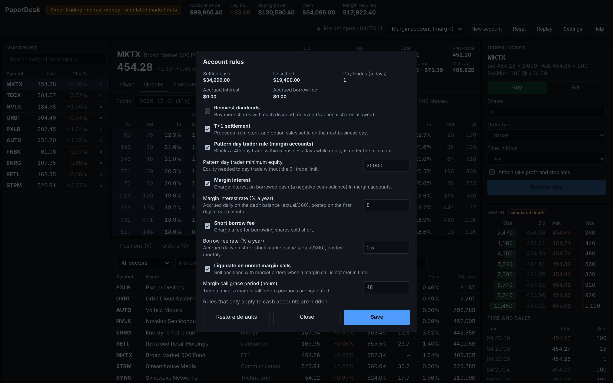

| Setting | Default | Range | Applies to |
|---|---|---|---|
| Reinvest dividends | off | | both |
| T+1 settlement | on | | both |
| Buy only with settled cash | on | | cash accounts |
| Pattern day trader rule | on | | margin accounts |
| Pattern day trader minimum equity | 25000 | 0 to 100,000,000 | margin accounts |
| Margin interest | on | | margin accounts |
| Margin interest rate (% a year) | 8 | 0 to 50 | margin accounts |
| Short borrow fee | on | | margin accounts |
| Borrow fee rate (% a year) | 0.5 | 0 to 200 | margin accounts |
| Liquidate on unmet margin calls | on | | margin accounts |
| Margin call grace period (hours) | 48 | 0 to 720 | margin accounts |

Cash dividends are always paid; that cannot be turned off.

### Creating and resetting accounts

**New account** asks for a name (up to 40 characters), a type (Margin or Cash) and starting cash (up to
1,000,000,000). Type plain digits, with no commas: "1,000" is not accepted and currently shows the
unhelpful message "Internal Server Error". **Reset** erases the selected account's positions, orders and
history and starts again with the cash you enter; it cannot be undone. There is no screen to delete an
account.

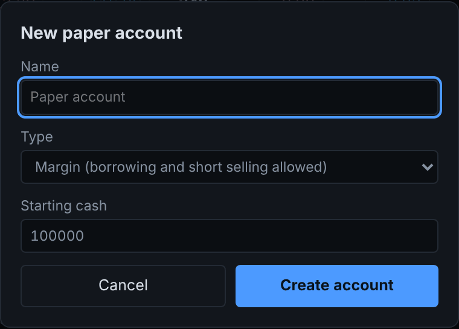

---

## 8. Options

Open a symbol and choose the **Options** tab.

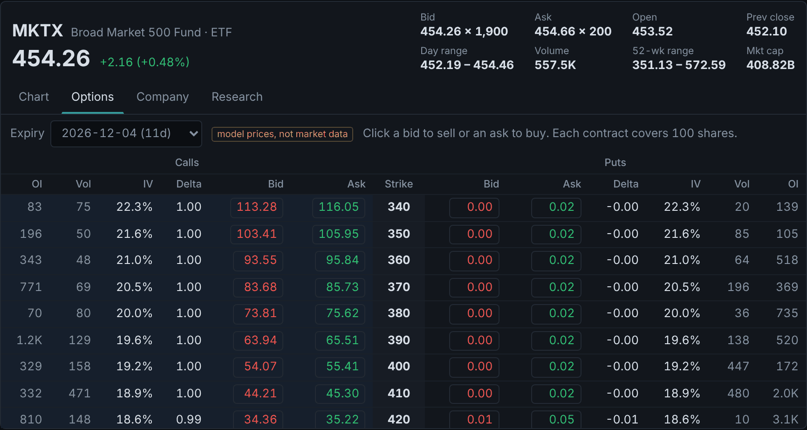

- Choose an **Expiry** from the list. It shows weekly Friday expiries (moved back a day when Friday is
  a holiday) and monthly expiries.
- The table has **calls on the left and puts on the right**, with the **strike** price in the middle.
  Rows shaded as in the money are those where the option has value if exercised now. Each side shows
  open interest (OI), volume, implied volatility (IV), delta, bid and ask. Strikes run about 25% above
  and below the stock price.
- **Click an ask price to buy** that contract, or **a bid price to sell** it. The ticket opens with a
  one-contract limit order a little through that price: 2% (at least 5 cents) above the ask for a buy,
  below the bid for a sell. The ticket says so under the limit. The order still fills at the market
  price; the margin only keeps it from resting unfilled when the price moves between your click and
  Place. Change the limit to wait for your own price, then Review and Place as usual. One
  contract covers **100 shares**, so a price of 5.00 costs $500. The fee is $0.65 per contract.
- On the ticket, option actions are called **Buy to open**, **Sell to open** (writing the option),
  **Buy to close** and **Sell to close**.

### Model prices and "indicative"

With simulated prices, **every option price is a model price**. The chain says "model prices, not
market data". PaperDesk calculates it with the Black-Scholes formula, a fixed 4% interest rate, and the
stock's own volatility with a skew (puts costing more than calls). The bid and ask are built around that
price with a spread of about 1.2% plus a cent. The open interest, volume and quote sizes are
**invented** to look plausible. They are not data.

With a real Alpaca key (section 13), the chain uses Alpaca's quotes. On the free plan these are the
**indicative** feed: Alpaca describes it as a free feed where trades are delayed and quotes are modified.
So even real option quotes are approximate and not those of the options exchanges. The chain says
"Alpaca indicative option feed …". A contract Alpaca does not quote is priced by the model and the
chain counts those ("· N model-priced"). Orders fill against the provider's quote when it is under 15
minutes old, and against the model otherwise.

The model is **European-style**: it prices an option as if it could be exercised only at expiry. Real
US stock options are American-style, so real prices differ, mostly for deep in-the-money puts and for
calls before a dividend.

### Exercise and assignment at expiry

At the **close on the expiry date** (4:00 pm New York time, 1:00 pm on an early close), PaperDesk
settles every option you hold:

- If the option is **in the money by at least one cent**, it is **exercised** automatically if you
  are long, or you are **assigned** if you are short. A call holder buys 100 shares per contract at
  the strike; a put holder sells 100 shares per contract at the strike. The writer takes the other
  side. You can see these as fills of kind "exercise" or "assignment". No fee is charged.
- Otherwise the option **expires worthless**.
- Open orders on an expired option are canceled.

There is **no early assignment**: a short option is never assigned before its expiry, which is kinder
than real life. If you have no cash or shares to settle in a **margin account**, the account can go
into debit and may be margin-called.

### Cash-account limits

A cash account cannot sell short stock, cannot write an **uncovered call**, and must have **strike × 100**
in cash set aside to write a put. A long option is not cover. At expiry, a cash account that cannot pay
for or deliver the shares does not get them: those contracts are closed for their intrinsic value in
cash instead (fill kind "closed at expiry"), which a real broker would do just before the final bell.

Spreads whose short leg is not covered in one of those ways need a **margin account**.

**Will change:** multi-leg strategies (spreads and so on) are supported by the engine but not yet by the
ticket on this branch. The new ticket and strategy builder will update this section.

---

## 9. Reports

Open the **Reports** tab in the bottom panel. All figures come from the simulated account. Five views:
**Overview**, **Gains**, **Statements**, **Journal**, **Export**.

### Overview

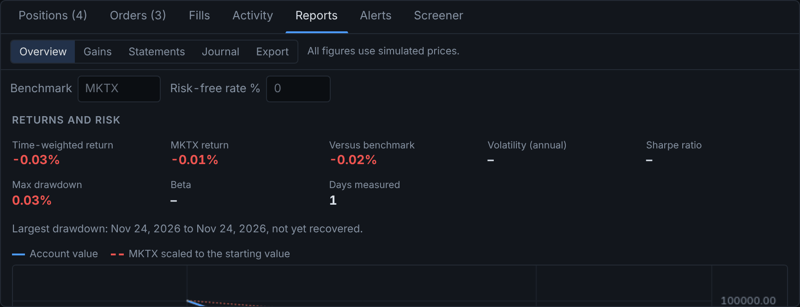

Two boxes at the top: **Benchmark** (a symbol to compare against; empty means the default for the data
you are using: MKTX with simulated prices, SPY with real data. Your choice is remembered in this browser) and **Risk-free rate %** (used only for
the Sharpe ratio; default 0). The statistics:

**Returns and risk**

- **Time-weighted return**: how much the account grew, with deposits and withdrawals taken out. It is
  the account's percentage gain since it was created or reset.
- **<Benchmark> return**: the benchmark's price change over the same period.
- **Versus benchmark**: your time-weighted return minus the benchmark's return.
- **Volatility (annual)**: how much your daily returns swing: their standard deviation times the
  square root of 252. Needs at least two daily returns.
- **Sharpe ratio**: average daily return above the risk-free rate, divided by its standard deviation,
  times the square root of 252. Higher is steadier. Needs at least two daily returns.
- **Max drawdown**: the biggest fall from a peak to a later low, as a percentage. Hover for the dates;
  the notice below says whether it has recovered.
- **Beta**: how strongly your daily returns move with the benchmark's (1 moves with it, 0 not at all).
- **Days measured**: the number of days (a day ends at midnight New York time) used for the daily
  figures.

The line chart shows your account value against the benchmark scaled to the same starting value. The
account is sampled about once a minute while PaperDesk is running.

**Closed trades.** A "trade" here is one **closed tax lot**: each time a fill closes part of an earlier
purchase, that is one closed lot. One order can close several lots.

- **Closed lots**: how many.
- **Win rate**: closed lots with a gain, divided by all closed lots.
- **Average win** and **Average loss**: the average gain and the average loss.
- **Profit factor**: total of all gains divided by total of all losses (shown "–" when there are no
  losses).
- **Expectancy**: the average gain or loss per closed lot.
- **Largest win**, **Largest loss**.
- **Average holding time**: how long lots were held before closing.

Tables below break these down **by side** (long or short), **by instrument** (stocks or options) and
**by symbol**.

**Exposure.** **Long** and **Short** are the market value of what you hold each way. **Gross leverage**
is long plus the size of short, divided by account value; **Net leverage** is long minus the size of
short, divided by account value. The sector table groups by the company's sector. Options count at their
market value, not adjusted for how much they move with the stock.

### Gains

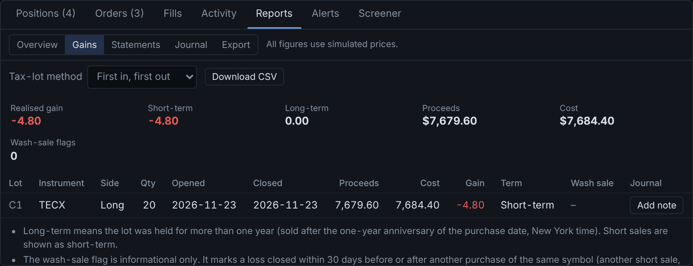

The realised gains report lists every closed lot: instrument, long or short, quantity, opened and closed
dates, proceeds, cost, gain, term and wash-sale flag. The totals at the top are **Realised gain**,
**Short-term**, **Long-term**, **Proceeds**, **Cost** and **Wash-sale flags**. Gains leave out fees,
which are reported separately.

- **Term**: a lot is **long-term** if it was held for more than one year (sold after the one-year
  anniversary of the purchase date, New York time); otherwise **short-term**. Short sales always count
  as short-term.
- **Tax-lot method** chooses which earlier purchase a sale closes: **First in, first out** (oldest
  first, the default), **Last in, first out** (newest first), or **Highest cost first** (the lot that
  gives the smallest gain). A change applies only to trades closed after you make it. For a short
  position, "highest cost" means the lot sold at the lowest price.
- **Wash-sale flag**: marks a loss on a lot closed within 30 days before or after another purchase of
  the same symbol (another short sale for a short lot). It is **informational only**. It does not look
  for similar securities, does not change your cost basis and does not defer any loss. This is not tax
  advice and PaperDesk is not a tax tool.
- **Download CSV** saves the table. **Add note** attaches a journal note to a lot.

### Statements

Choose a **Month** to see a monthly statement: opening account value, deposits and withdrawals,
realised profit and loss, fees, other income and charges (dividends, interest, borrow fees), the change
in unrealised profit and loss, closing account value, cash, trade count, amounts bought and sold, and the
positions at month end. The figures reconcile with each other. The current month is marked as in
progress. **Open printable statement** opens a page you can print or save as PDF from your browser. The
statement notes say it is a paper statement, not a brokerage record.

### Journal

Write notes about trades. Pick **Closed trade** or **Order**, pick the item, write a note and optional
comma-separated tags, and press **Add entry**. Filter by tag, edit or delete entries, and download the
journal as CSV. Notes are saved with your account data.

### Export

Downloads, as comma-separated files for a spreadsheet: **Fills**, **Orders**, **Ledger**, **Positions**,
**Realised gains** and **Journal**. Times are in UTC and amounts are exact. Text that starts with a
character a spreadsheet could treat as a formula gets an apostrophe in front for safety.

---

## 10. Replay mode

Replay plays back one past trading session with a clock you control, so you can practise without waiting.
You trade in a **sandbox account**; your normal accounts are saved first and are untouched.

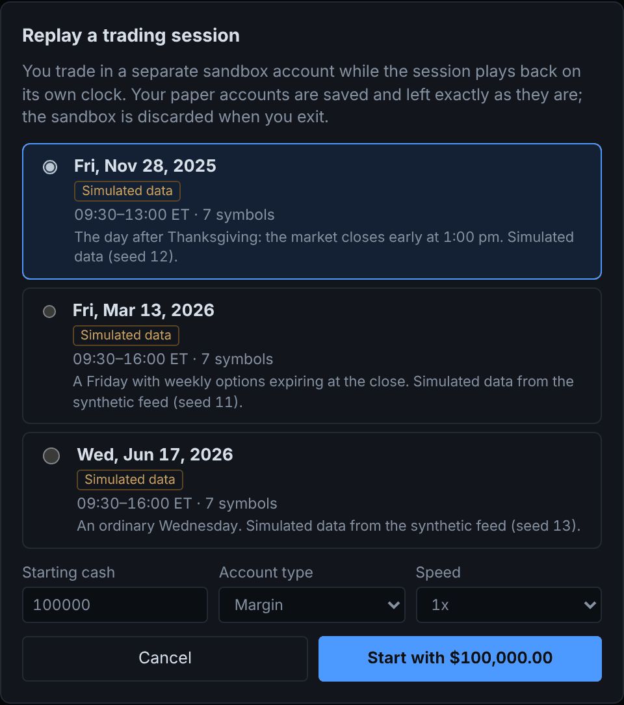

1. Press **Replay** in the top bar (or the menu on a phone).
2. Choose a session. Each shows its date, hours in New York time, number of symbols and whether it is
   "Simulated data" or "Recorded data". Three simulated sessions come with the program: 28 Nov 2025 (the
   day after Thanksgiving, early close at 1:00 pm), 13 Mar 2026 (weekly options expire at the close) and
   17 Jun 2026 (an ordinary day). Each has seven fictional symbols.
3. Choose starting cash, **Account type** and **Speed**, then press **Start with …**. The replay starts
   **paused**; press **Play** when ready.

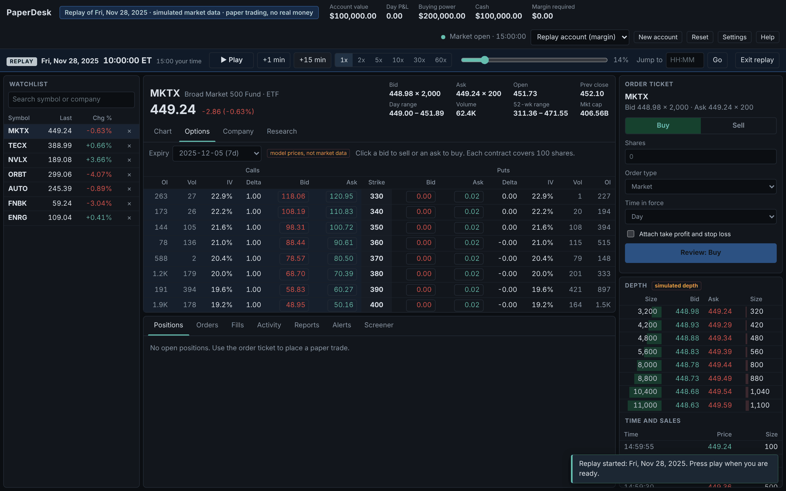

While it runs the banner turns blue and reads "Replay of <date> · simulated market data · paper
trading, no real money". The bar shows the date, the New York time ("09:45:00 ET") and your local time,
and has:

- **Play / Pause**, **+1 min** and **+15 min** steps, and speed **1x, 2x, 5x, 10x, 30x, 60x**.
- A **progress slider** and a **Jump to** box (type a New York time such as `11:30`, then Go). Both only
  move **forward**: a replay cannot go back, because your orders cannot be undone. To see an earlier
  part, exit and start again.
- **Exit replay** returns to your normal accounts. The sandbox is thrown away.

Everything works as usual on the replayed market: charts, options, orders, reports and settings. Orders
fill, day orders expire, options expire and exercise, and dividends happen on the replayed clock. The
same session with the same actions gives the same result every time. Your live accounts are not ticked
while a replay runs: live orders do not fill and the live simulated market does not move until you
exit. If the server restarts during a replay it comes back in normal mode; the replay is not resumed.

Sessions made from real data you record yourself are labelled "Recorded data". To make or build
sessions, see [REPLAY.md](REPLAY.md). A session built from one-minute bars is approximate inside each
minute (REPLAY.md explains how).

---

## 11. Alerts, watchlist, screener and research

**Alerts.** Open the **Alerts** tab. Type a stock symbol, choose "rises to" or "falls to", enter a price
and press **Add alert**. When the last price reaches the level, a message appears at the bottom right
("Alert: MKTX rose to 460.00") and the alert shows "Triggered" with the time. An alert fires only once
and only works on stocks, not options. It can fire only while PaperDesk is running, and the message
shows only if PaperDesk is open in a browser at that moment (later you can still read "Triggered" in
the tab). There is no sound or phone notification. If the price is already past the level when you add
it, the alert fires at once. **Remove** deletes an alert.

**Watchlist.** One list, called Main. Add by searching; remove with the ×. With real data, a new
install starts with SPY, QQQ, IWM, AAPL, MSFT, NVDA, AMZN, GOOGL, META and TSLA. The simulated list
starts with the ten fictional companies.

**Screener.** The **Screener** tab lists the symbols and can filter them by sector (Technology, Health
Care, Financials, Energy, Consumer, Industrials, Utilities, Communication, ETF), minimum and maximum
price, minimum change %, maximum P/E and minimum dividend yield %. Click a row to open it. With the
simulated feed it covers the ten fictional companies. It has not been checked with real data (no live key was available), so how complete the P/E and yield columns are then is unknown.

**Research.** With a real provider: **News**, **Earnings** dates (needs a Finnhub key), **Dividends and
splits**, and **Fundamentals** (also Finnhub), each with a source line, an updated time and a "stale"
note if a refresh failed. Without a provider the same sections hold simulated research (statements,
earnings reports that gap the price and move option volatility, news, an economic calendar), every block
labelled "Source: Simulated"; see `docs/SIMULATED_RESEARCH.md`. Links in news open in a new tab.

---

## 12. Using PaperDesk on a phone

PaperDesk's phone layout is built into the same page. It switches on automatically when the browser
window is narrow (under 900 pixels), or a phone is held sideways. You do not install anything on the
phone. Both the PC and the phone must be on the **same home Wi-Fi network**, and PaperDesk must be
running on the PC.

**Honest limits first.**

- Phone access uses plain **HTTP**, not HTTPS. The traffic is **not encrypted**. Anyone on the same
  Wi-Fi who is watching the network could read it, including the passcode when you type it and the
  sign-in cookie, and then act as you. This is acceptable for paper money **on your own home network**.
  **Never** use it on cafe, hotel, office, school or any shared Wi-Fi.
- Use a passcode you have **never used anywhere else**.
- A phone sign-in is one shared passcode for the whole program, not a personal account.
- It has been checked with automated tests on emulated phones. It has **not** been tried on a real phone
  at the time of writing. Report anything odd.

### Turn it on (Windows)

1. Open the PaperDesk folder. Find the file **`.env.example`**. Right-click it, choose **Copy**, then
   right-click an empty space and choose **Paste**. Rename the copy to **`.env`** (exactly: a dot, then
   `env`, no `.txt`). Windows may warn that the file may become unusable; choose **Yes**. If you cannot
   see file extensions, turn on **View > Show > File name extensions** in File Explorer first.
   Alternative: open Notepad, type the lines in step 3, choose **File > Save as**, type `".env"`
   (with the quotes) as the file name, set **Save as type** to **All files**, and save it in the
   PaperDesk folder.
2. Right-click `.env` and choose **Open with > Notepad**.
3. Find these two lines near the middle (they start with `#`, which makes them ignored). Remove the `#`
   and the space after it, and replace the passcode text with your own, **keeping the single quotes**:

   ```
   PAPERDESK_LAN=1
   PAPERDESK_PASSCODE='your own long passcode here'
   ```

   Use at least 8 characters, with at least four different characters. Do not use the example text, a
   common word or a number sequence: PaperDesk refuses to start with a weak passcode.
4. Save the file (Ctrl+S) and close Notepad.
5. If PaperDesk is running, stop it (Ctrl+C in its window). Double-click **`run.bat`**.
6. The window now prints something like this:

   ```
   LAN mode is on: devices on your network can open PaperDesk after entering the passcode.
   On your phone, open this address:
       http://192.168.1.20:8000
   The phone must be on the same Wi-Fi network as this computer.
   Windows may ask whether to allow Python through the firewall: allow it on Private networks only, never on Public networks.
   This is plain HTTP: anyone on the same network could watch the traffic. ...
   ```

   The address in the window is yours (it will differ).
7. **Windows Defender Firewall** probably shows a window "Allow Python to communicate on these
   networks". Tick **Private networks**. **Untick Public networks.** Then press **Allow access**.
8. On the phone, join the **same Wi-Fi network** as the PC, open the phone's browser and type the
   address from step 6 exactly, including `http://` and the `:8000`.
9. The phone shows the sign-in screen. Type the passcode and press **Sign in**.

If there are several addresses listed, try the first, then the others. If the window cannot find the
address, open **Command Prompt**, type `ipconfig`, and look for **IPv4 Address** under your Wi-Fi
adapter; type `http://` + that number + `:8000`.

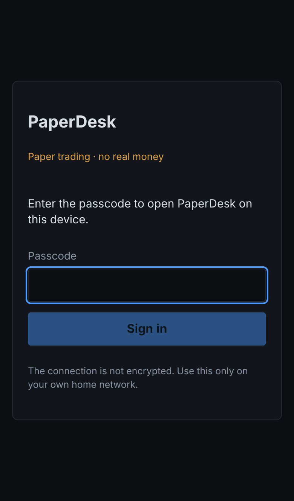

On the PC's own browser you do **not** have to sign in (unless you set `PAPERDESK_LOOPBACK_BYPASS=0`).

### If the phone cannot connect

1. Is PaperDesk's window still open on the PC, and does it say "LAN mode is on"?
2. Is the phone on the same Wi-Fi (not mobile data, not a guest network)? Many routers isolate guest
   networks.
3. Did you allow Python on **Private networks** in the firewall? If you pressed Cancel or ticked only
   Public: open **Windows Security > Firewall & network protection > Allow an app through firewall**,
   press **Change settings**, find **Python**, tick **Private**, and press OK. Windows menus differ a
   little between versions.
4. Does Windows call your Wi-Fi a **Private network**? Open **Settings > Network & internet > Wi-Fi >**
   your network, and under **Network profile type** choose **Private**. (Do not do this on a public
   network.)
5. Typing the PC's computer name (for example `http://mypc:8000`) is **refused** unless you add it to
   `PAPERDESK_ALLOWED_HOSTS`. Use the numeric address.

### Signing in and out

- After the passcode, the phone stays signed in until it has been **unused for 30 days**
  (`PAPERDESK_SESSION_DAYS`). Sign-ins survive a PaperDesk restart.
- To sign out on the phone: open the **menu** (top right) and press **Sign out**. Do this on any phone
  you lend or lose. The button appears only on devices that had to sign in.
- **Changing the passcode** in `.env` and restarting signs every device out. So does deleting
  `backend\data\sessions.json`.
- If the sign-in page says "Too many wrong passcodes. Try again in N seconds.", wait. After three
  wrong tries each further miss waits 1, 2, 4 ... seconds, up to 15 minutes. After 30 wrong tries
  within 15 minutes from all devices together, every sign-in pauses for a while. If it was not you,
  someone on your network may be guessing: restart PaperDesk (this clears the counters) and **change the
  passcode**.
- **Locked out because you forgot the passcode?** Open `.env` on the PC, set a new
  `PAPERDESK_PASSCODE`, and restart. The PC's browser never needed it.

### Using the phone screen

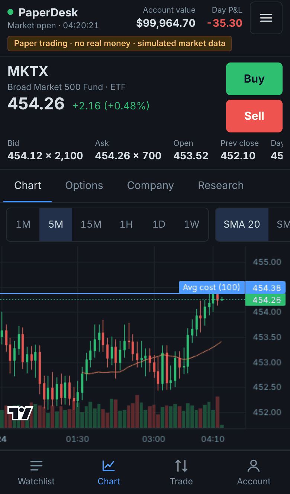

The bottom bar has four views: **Watchlist**, **Chart**, **Trade** and **Account**. The **menu** button at
the top right opens a sheet with the account picker, your numbers, and the buttons New account, Reset,
Replay, Settings, Help and (when you signed in) Sign out. On the **Chart** view, **Buy** and **Sell**
buttons open the ticket for that symbol. On **Trade**, once you press Review, **Place paper order**
stays pinned above the tab bar. **Account** shows buying power and the seven tabs (Positions to
Screener). In the option chain, a Calls / Puts / Both switch picks the side to show.

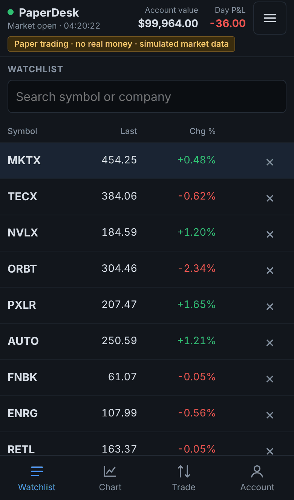
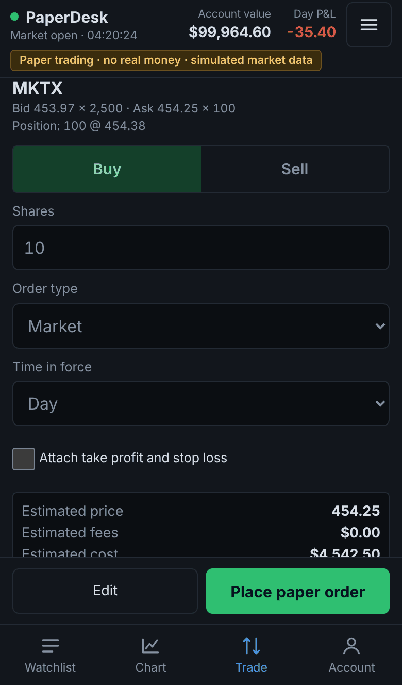
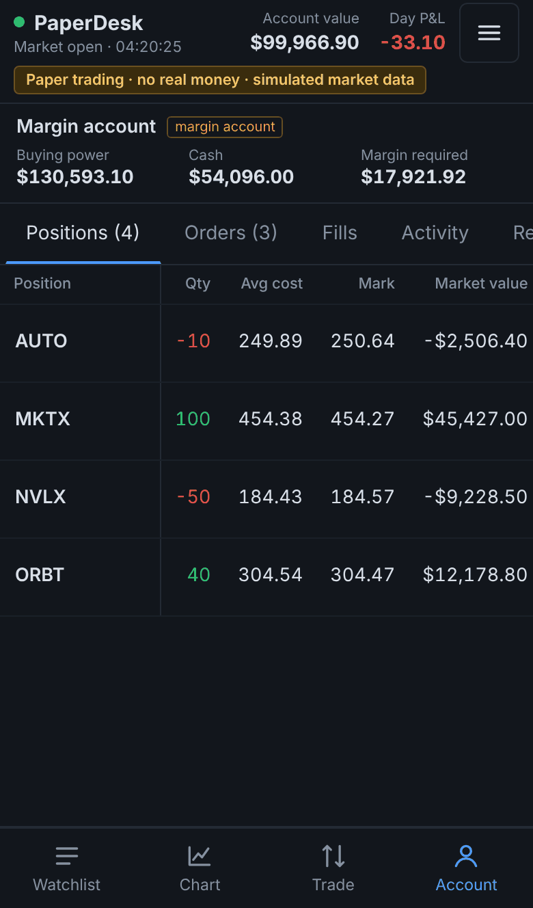
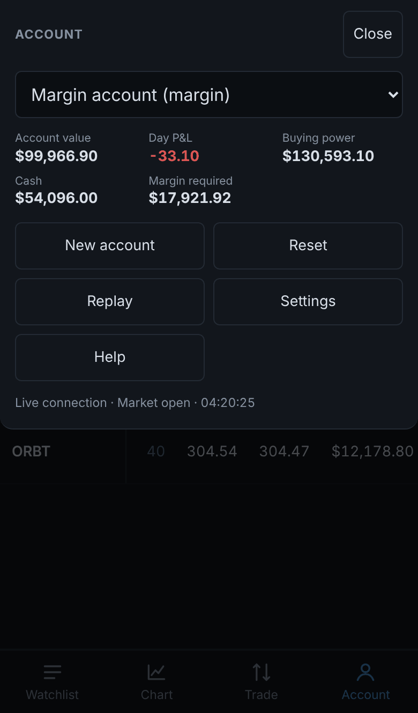

---

## 13. Real market data

By default PaperDesk shows simulated prices. You can switch to real US stock and option quotes with a
**free** Alpaca account, and optionally add a free Finnhub account for earnings dates and
fundamentals. **Your orders are still simulated.** Only the prices are real.

**Important:** at the time of writing, the live data adapter has **never been run with a real key**. It
was built and tested only against saved example responses and a fake key. Expect rough edges and report
what you find. The provider facts below are from the providers' own pages, read on the date the data
notes were written; they can change. See [DATA_PROVIDERS.md](DATA_PROVIDERS.md) for the details and
sources.

### Sign up for Alpaca (paper-only, free)

1. Go to <https://alpaca.markets> and choose **Sign up**. Use your email. A **paper-only** account is
   enough: you do not need to fund an account or provide identity documents.
2. Confirm your email and sign in to the dashboard at <https://app.alpaca.markets>.
3. Make sure the account switcher at the top left shows your **Paper** account.
4. On the right, under **API Keys**, choose **Generate New Keys**. Copy the **key ID** (it starts with
   `PK`) and the **secret** straight away. **The secret is shown only once.**

### Put the keys in `.env`

1. Open `.env` in Notepad (create it from `.env.example` as in section 12).
2. Add these two lines, with your own values and nothing else on the lines:

   ```
   APCA_API_KEY_ID=PKxxxxxxxxxxxxxxxxxx
   APCA_API_SECRET_KEY=xxxxxxxxxxxxxxxxxxxxxxxxxxxxxxxxxxxxxxxx
   ```

3. For Finnhub (optional): register at <https://finnhub.io/register>, copy the API key from its
   dashboard, and add a line `FINNHUB_API_KEY=your-key`.
4. Save the file. **Never share `.env` or put it where others can read it.** It is kept out of Git on
   purpose.
5. Restart PaperDesk. The banner should now read "Paper trading · no real money · real-time IEX prices
   via Alpaca" (hover for detail).

### Check it works: the check command

Before relying on it, run the built-in check. In a Command Prompt, in the PaperDesk folder:

```
cd backend
.venv\Scripts\python -m app.marketdata.alpaca --check
```

(On macOS and Linux: `.venv/bin/python -m app.marketdata.alpaca --check`.) It tries five things and
prints one line each, starting with **PASS** or **FAIL**, and never prints your keys:

| Line | What it checks |
|---|---|
| `assets` | the list of tradable symbols loaded from Alpaca |
| `quote` | a live quote for SPY |
| `bars` | thirty daily chart bars for SPY |
| `option chain` | the list of SPY option expiries and a chain |
| `stream` | the live price connection (waits about 8 seconds; "no messages: the market may be closed" is fine outside market hours) |

The command finishes with a failing status if any line failed. If the keys are missing you get
`FAIL keys: APCA_API_KEY_ID and APCA_API_SECRET_KEY are not set (environment or .env)`. With a wrong
key, for example, you get lines such as:

```
FAIL quote: Alpaca returned HTTP 401 for /v2/stocks/snapshots: 401 Authorization Required
FAIL stream: Alpaca rejected the API key on the stream (auth failed). Check APCA_API_KEY_ID and APCA_API_SECRET_KEY; keys from a reset paper account must be regenerated.
```

The check may also print a few extra lines (a Python warning, or a line such as "Alpaca bars SPY 1d:
Alpaca returned HTTP 401 …"). Those are noise; look at the PASS and FAIL lines. A `FAIL assets` that
mentions `paper-api.alpaca.markets` means PaperDesk could not reach Alpaca's symbol service.

### What the free plan's data is and is not

- **Stocks: IEX only.** The free plan's real-time stock data comes from one exchange, IEX, which Alpaca
  says is about 2.5% of market volume. Prices and sizes can differ from the whole market ("SIP") that
  your brokerage app shows. Quote sizes are small.
- **30 streamed symbols.** Only 30 symbols are streamed live at once, in this order of importance: symbols
  with open orders, then positions, then what your open browser tabs show, then the watchlist. Others
  are refreshed by polling every 5 seconds (every 60 seconds when the market is closed).
- **Options are indicative.** See section 8. They are not exchange quotes.
- **Daily and weekly chart bars** use consolidated history that ends about 16 minutes ago; if that is
  refused they fall back to IEX bars.
- **Market hours.** With real data PaperDesk follows US market hours and holidays (`us`). Orders
  placed when the market is closed wait for the open.
- **Limits.** Alpaca allows 200 data requests per minute on the free plan; PaperDesk stays under it. One
  program can hold the live connection per key: if another tool is using your key, PaperDesk says
  "connection limit exceeded" and falls back to polling.
- **Outages.** If the data stops, the banner says "prices may be stale (feed interrupted)", and
  PaperDesk says so rather than showing old prices as current.
- **Fallback.** If Alpaca rejects the key, or cannot be reached **when PaperDesk starts**, PaperDesk
  falls back to simulated prices and the banner (hover) says why. Be aware that this also switches you to
  your *simulated* accounts (next heading). Fix the cause and restart.
- **Research.** News and corporate actions come from Alpaca; earnings and fundamentals from Finnhub
  (free plan, personal use only). Both providers' terms limit use to personal, non-commercial use.
- **Charts show real prices; the depth ladder does not.** The depth ladder stays "simulated depth".

### Live mode and simulated mode keep separate state

When real data is on, PaperDesk keeps its accounts in the **`alpaca` subfolder** of the data folder
(`backend\data\alpaca`). Your simulated accounts, with their fictional symbols, are **not mixed in**. The
first time you use real data you get two fresh accounts (margin $100,000, cash $25,000) and the real
watchlist. If you remove the keys (or set `PAPERDESK_FEED=synthetic`) and restart, your simulated
accounts are back, untouched, and the real-data accounts wait in their folder. If you ever see your
accounts "disappear", check whether the banner says simulated or real: you may be in the other mode.

---

## 14. Troubleshooting

These are the messages you can actually meet, and what to do.

### Starting the program

| Message | Meaning and fix |
|---|---|
| `PaperDesk needs Python 3.11 or newer, and none was found.` | Python is missing, too old, or not on PATH. Install from python.org with "Add python.exe to PATH" ticked, then start again. On Windows, Microsoft's built-in "python" shortcut (an app execution alias) can stand in for a real install and does not count: install from python.org. |
| `Installing the Python packages failed. Check your internet connection and run this again.` (macOS/Linux) | The first start could not download packages. Check the connection. |
| `PaperDesk could not start. The message above says why.` | Read the line above it. |
| Address already in use / "only one usage of each socket address" | Another program (or another copy of PaperDesk) is using port 8000. Close it, or choose another port (section 2). |
| `PAPERDESK_PASSCODE is too short: use at least 8 characters. PaperDesk did not start.` | Choose a longer passcode in `.env`. |
| `PAPERDESK_PASSCODE is the example text or too simple: …` | Pick your own passcode: 8 or more characters, 4 or more different characters, not a common word or sequence. |
| `LAN mode (PAPERDESK_LAN=1) needs a passcode: …` | Phone access needs `PAPERDESK_PASSCODE` as well. |
| `PAPERDESK_LAN must be 1 (on) or 0 (off), not …` (the name varies) | A setting has an invalid value. Use 1 or 0. |
| `PAPERDESK_BIND=… publishes PaperDesk to your network, but LAN mode is off…` | Docker only: turn on LAN mode with a passcode or set the bind address back to 127.0.0.1. |
| `HOST=… would let other devices reach PaperDesk without a passcode. …` | Leave `HOST` unset unless you are using LAN mode. |
| `PORT must be a number from 1 to 65535, not …` | Fix the `PORT` value. |
| `PAPERDESK_SESSION_DAYS must be a number of days between 0 and 3650, not …` | Fix the number. |
| `Could not read the settings file …` | `.env` could not be read. Save it as plain text (UTF-8). |

### In the browser

| Message | Meaning and fix |
|---|---|
| `Cannot reach the PaperDesk server (…). Check that it is running, then reload.` | The black window is closed or crashed. Start `run.bat` again and reload the page. |
| "Connecting…" / "Reconnecting…" in the status area, and a red dot | The live connection to the server dropped. It retries by itself. If it stays, check the server window. |
| `This order would be rejected: <reason>.` | The ticket checked the order and refused it. The reasons: `insufficient buying power`, `insufficient cash`, `short selling needs a margin account`, `uncovered calls need a margin account`, `insufficient cash to secure short options`, `no quote available for X` (the symbol has no price right now), `unknown symbol X`, `quantity must be positive and at most 1,000,000`, `fractional shares are limited to market and limit day orders`, `limit price is required`, `stop price is required`, `take profit must be on the profitable side of the entry price`, `stop loss must be on the losing side of the entry price`, `this option has expired`. |
| `Pattern day trader rule: this account has made N day trades …` | See section 7. Close positions only, or wait for the date it gives, or raise the account's equity, or change the rule in Settings. |
| `Cash accounts can only buy with settled cash: …` | Sale money has not settled yet. Wait for the date it gives, or turn the rule off in Settings. |
| `Margin call: account value … is below … maintenance requirement. Only closing orders are accepted until this is resolved.` | Section 7. Close positions or Reset. |
| `Prices unavailable for X: margin checks are paused until they return.` | A symbol you hold has no price. Margin checks are paused. |
| `Could not load chart data: …`, `Could not load the option chain: …`, `Could not load fills: …` | A request to the server failed; the text after the colon is the cause. Reload; check the server window. |
| `Research data is unavailable. …` | The feed has no research at all (for example a replay of non-simulated symbols). See section 13. |
| `Account value –` and dashes everywhere | Not connected to the server yet, or signed out. |
| "Internal Server Error" when creating an account | You typed a starting amount with a comma or letters. Use plain digits. |

### Signing in (phone)

| Message | Meaning and fix |
|---|---|
| `That passcode is not correct.` | Try again carefully; the passcode is case-sensitive. |
| `Too many wrong passcodes. Try again in N seconds.` | Wait. See section 12. |
| `Your sign-in has ended. Enter the passcode to continue.` | Your session expired or the passcode was changed. Sign in again. |
| `Cannot reach the PaperDesk server. Check that it is running and that this device is on the same network.` | The PC is off, PaperDesk is closed, the firewall blocks it, or the phone is on another network (section 12). |
| `This PaperDesk server does not answer to that host name. Open it with the address the server printed when it started.` (HTTP 421) | You typed a name instead of the numeric address. |
| `Refused a request that came from another website.` | The page was opened from somewhere other than PaperDesk's own address. Open the printed address directly. |
| `Sign in required: this PaperDesk server needs its passcode.` | Sign in. |
| The sign-in page shows but never accepts the right passcode | Check the passcode in `.env` (single quotes, no stray spaces) and that you restarted PaperDesk after editing it. |

### Replay

| Message | Meaning |
|---|---|
| `A replay cannot go back in time. Exit and start the session again to see an earlier part.` | Replay moves forward only. |
| `Enter a time as HH:MM, New York time.` | The Jump box needs for example `11:30`. |
| `The session ends at HH:MM New York time.` | You asked to jump past the end. |
| "Running behind" | The computer cannot keep up with the speed you chose. Lower the speed. |

### Real data

| Message | Meaning and fix |
|---|---|
| `No Alpaca API key is set (APCA_API_KEY_ID and APCA_API_SECRET_KEY), so PaperDesk is showing simulated prices …` | Normal when you have not added keys. |
| `Alpaca rejected the API key (HTTP 401) …` | The key is wrong, or from a reset paper account. Generate new keys. |
| `Could not reach Alpaca to load the symbol list (…). Using simulated prices.` | No internet, or the connection is blocked. |
| Red notice: "Could not connect to Alpaca (…). Showing simulated data and your simulated accounts." | Alpaca was set up but failed at start-up. Your real-data accounts are kept untouched in their own folder; fix the cause and restart PaperDesk. |
| `connection limit exceeded` | Another program is using your key's live connection. Close it. |
| Banner: "prices may be stale (feed interrupted)" | The live data stopped. Wait, or restart. |

If something else goes wrong, the black window usually prints the reason. Keep it open and read it.

---

## 15. Glossary

Terms as they appear in PaperDesk.

**Account value (equity).** Cash plus the market value of positions (shorts subtract). Dividends owed to
you but not yet paid count in it.
**Ask.** The lowest price someone is offering to sell at. You buy at the ask.
**Assignment.** A short option seller being required to deliver on the contract. Here it happens
only at expiry.
**Average cost (avg cost).** What you paid per share or contract, on average, for what you hold.
**Benchmark.** A symbol to compare your results with.
**Beta.** How strongly your returns move with the benchmark's.
**Bid.** The highest price someone is offering to pay. You sell at the bid.
**Bid and ask size.** How many shares are on offer at each price. For stocks, real data multiplies
Alpaca's "round lots" by 100.
**Bollinger bands.** A chart indicator: a 20-bar average with lines two standard deviations either side.
**Bracket.** An entry order with a take-profit and a stop-loss exit attached; when one exit fills the
other is canceled.
**Buying power.** How much more you can buy. On margin accounts about twice spare equity (stocks); on
cash accounts, settled cash.
**Call.** An option giving the right to buy 100 shares at the strike price.
**Cash account.** An account with no borrowing and no short selling.
**Close.** (a) The end of the trading day. (b) To close a position: trade it back to zero.
**Contract.** One option, covering 100 shares.
**Day P&L.** Change in account value since the day began.
**Day trade.** Opening and closing a position on the same day.
**Delta.** How much an option's price moves for a $1 move in the stock (a call between 0 and 1, a put
between -1 and 0).
**Depth.** The ladder of bid and ask prices and sizes. Simulated in PaperDesk.
**Drawdown.** A fall from a peak to a later low.
**Dividend.** A cash payment per share from a company. **Ex-date**: the day the price drops; you must
hold the stock before it. **Pay date**: when the cash arrives.
**EMA.** Exponential moving average: an average that weights recent prices more.
**EPS.** Earnings per share.
**ETF (fund).** A fund that trades like a stock. MKTX is a fictional one.
**Exercise.** Using an option's right. Here done automatically at expiry if in the money.
**Expectancy.** Average gain or loss per closed lot.
**Expiry (expiration).** The date an option ends.
**Extended hours.** Trading before 9:30 and after 16:00 New York time.
**Fill.** An execution: all or part of an order trading. **Partial fill**: only part of the quantity.
**FIFO / LIFO.** Which earlier purchase a sale closes first: oldest (first in, first out) or newest
(last in, first out).
**Fill or kill / Immediate or cancel.** Time-in-force choices; see section 5.
**Good till canceled (GTC).** An order that stays until filled or canceled.
**Gross / net leverage.** Total long plus short exposure, or long minus short, as a share of account
value.
**Greeks.** Measures of how an option's price changes (delta, gamma, theta, vega, rho). The chain shows
delta.
**In the money (ITM).** An option that has value if exercised now: a call with the stock above the
strike, a put with the stock below it. **Out of the money**: the opposite. **Intrinsic value**: that
exercise value.
**Implied volatility (IV).** How much the market (or here, the model) expects the stock to swing,
inferred from the option price.
**Initial margin.** The share of a position you must fund yourself when opening it (50% for stock).
**Journal.** Your notes on trades and orders.
**Last.** The price of the most recent trade.
**Limit order.** An order with a worst acceptable price.
**Liquidation.** PaperDesk selling your positions after an unmet margin call.
**Long / short.** Owning something; or having sold something you do not own, hoping to buy it back
cheaper.
**Lot.** One purchase (or short sale) of a security, tracked separately for cost and gains.
**Maintenance requirement.** The minimum account value a margin account must keep.
**Margin account / margin.** An account that can borrow and sell short, and the rules that govern it.
**Margin call.** Account value below the maintenance requirement.
**Mark.** The price used to value a position: last trade for stocks, the middle of bid and ask for
options.
**Market cap.** Share price times shares outstanding.
**Market order.** An order to trade now at the best available price.
**Model price.** An option price calculated by a formula, not quoted by a market.
**Open interest (OI).** Number of contracts outstanding. Invented for model prices.
**Open P&L.** Unrealised profit or loss on what you hold.
**P/E.** Price divided by earnings per share.
**Pattern day trader (PDT).** The US rule limiting day trading in small margin accounts; see section 7.
**Position.** What you currently hold in a symbol.
**Premium.** The price of an option.
**Previous close.** The last price of the previous trading day.
**Profit factor.** Total gains divided by total losses.
**Put.** An option giving the right to sell 100 shares at the strike price.
**Realised / unrealised.** Profit or loss locked in by closing; or still open.
**Replay.** Playing back a past session with your own clock.
**RSI.** Relative strength index, a 0 to 100 momentum indicator; above 70 or below 30 is often read as
stretched.
**Sandbox.** The temporary account used in replay.
**Settled / unsettled cash.** Sale money that has or has not yet been paid out (one business day).
**Sharpe ratio.** Return above the risk-free rate per unit of volatility.
**Short selling.** Selling borrowed shares. **Borrow fee**: the charge for it.
**SIP.** The consolidated feed of all US exchanges. **IEX**: one exchange; the free Alpaca plan.
**Slippage.** The difference between the price you expected and the price you got.
**SMA.** Simple moving average.
**Spread.** The gap between bid and ask. (Also an option strategy.)
**Stop order.** An order that becomes active when a price is reached.
**Strike.** The price an option can be exercised at.
**T+1.** One business day after the trade.
**Take profit / stop loss.** Exit orders at a target price, and a protective price.
**Time in force.** How long an order lasts.
**Trailing stop.** A stop that follows the price.
**VWAP.** Volume-weighted average price for the day.
**Volatility.** How much a price swings.
**Wash sale.** A loss followed or preceded within 30 days by buying the same security. Flagged here for
information only.
